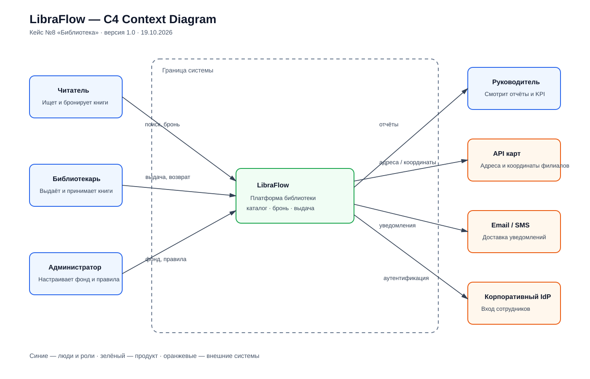

# C4 Context Diagram

## Граница контекста

В центре диаграммы находится LibraFlow как единая система. Внутрь не вынесены базы данных, API, очереди и внутренние сервисы: это следующий уровень C4 Container. На контекстном уровне показаны только роли людей и внешние системы, с которыми есть обмен данными.

## Взаимодействия

- Читатель ищет издания, создаёт бронь, продлевает выдачу и получает уведомления.
- Библиотекарь оформляет выдачу и возврат, а также видит ограничения.
- Администратор загружает фонд и настраивает правила.
- Руководитель получает отчёты по филиалам.
- LibraFlow загружает исходный фонд из CSV, а критические операции хранит в собственной базе.
- Email/SMS-провайдеры доставляют подтверждения и напоминания.
- Корпоративный IdP подтверждает учётные записи сотрудников.

## Кандидаты в контейнеры для следующего уровня

Web UI читателя, Web UI сотрудника, API приложения, сервис каталога, сервис операций фонда, сервис уведомлений, база данных, очередь задач, адаптер email и модуль отчётности; API карт остаётся опциональным адаптером.

## Артефакт

Версия 1.0, 19.10.2026. Автор: команда проекта.
